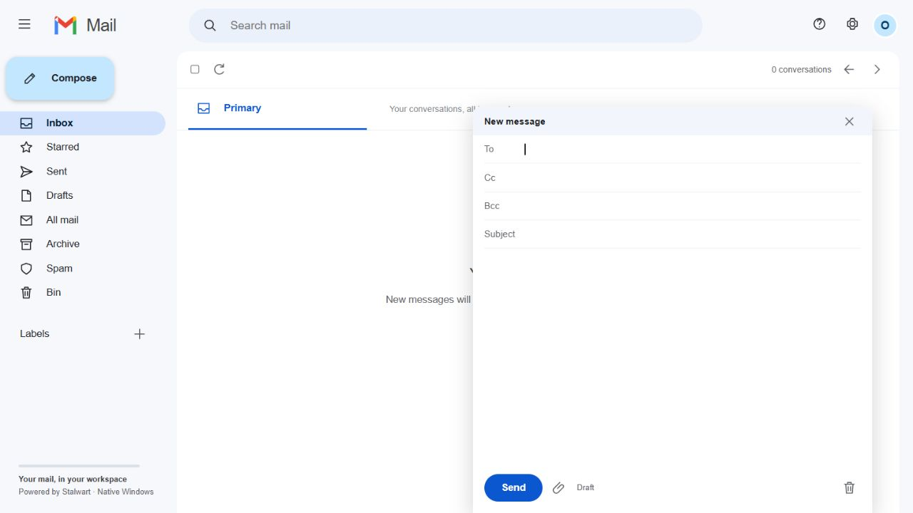

# Mail

**Your inbox, connected to One Workspace.**

Mail is a native Windows email app with a Gmail-style interface, MyAccounts
sign-in and a real Stalwart mail server. Use it as part of
[One Workspace](https://github.com/oneworkspacestudio/one-workspace), or run it
independently with your own account provider and domain.

[Download Mail for Windows](https://github.com/oneworkspacestudio/mail/releases)
· [Get One Workspace](https://github.com/oneworkspacestudio/one-workspace/releases)
· [Setup and technical guide](workspace-mail/README.md)

## Calendar, Mail and Contacts together

The new [shared-service preview](https://github.com/oneworkspacestudio/calendar)
lets Mail use the same Stalwart backend as My Calendar and My Contacts. Each app
runs independently. Installing or removing an app keeps the other apps and your
data intact. Download the shared Windows package from the Calendar repository.

The published Mail-only releases described below use the earlier private-engine
mode. They are not silently converted. See the [shared setup guide](workspace-mail/docs/SHARED-BACKEND.md)
for build, storage and migration boundaries.

## What you can do

- Read, compose, reply, forward and search your email in the browser.
- Organise messages with stars, labels, archive, spam and bin folders.
- Save drafts automatically and upload or download attachments.
- Sign in with MyAccounts. Workspace prepares an admin mailbox and creates
  mailboxes for new MyAccounts users automatically.
- Use readable addresses such as `admin@your-domain` and `username@your-domain`.
- Connect your domain through Workspace's Cloudflare setup, with progress,
  incoming connection checks and recovery guidance.

## Get started with One Workspace

1. Download the [Workspace installer](https://github.com/oneworkspacestudio/one-workspace/releases).
2. Create your account, choose your Workspace folder and connect your domain
   if you want public access and email hosting.
3. Launch Workspace and open **Mail**. Sign in with MyAccounts.

Workspace supplies the Mail connection settings and manages mailbox provisioning.
Normal installation fetches the latest published Workspace application bundle
and verifies its checksums.

## Run Mail independently

Download `Mail.exe` from [Releases](https://github.com/oneworkspacestudio/mail/releases)
and run it on 64-bit Windows. Those earlier Mail-only release executables include the pinned Windows mail
engine and open their setup wizard in your browser. No Docker or separate Go,
Rust or Node installation is needed to run it.

Standalone setup connects to your own MyAccounts OIDC client or existing
Stalwart mailbox credentials. See the [Mail guide](workspace-mail/README.md) for
setup, command-line options, storage, backups and local builds.

## Hosting and preview status

Mail is in preview. Incoming Internet email needs reachable SMTP port 25;
router forwarding, Windows firewall policy, shared NAT or ISP restrictions may
require user action or an inbound gateway. Setup reports network status and
provides next steps. A working web address alone does not establish mail delivery.

This is not complete Gmail feature parity. Offline mail, scheduled sending,
Gmail-style thread cards and rich HTML composition are not implemented. See
[the feature and hosting details](workspace-mail/README.md) before deployment.

## Source and licensing

The Windows app is in [`workspace-mail/`](workspace-mail). It embeds the pinned,
unmodified official Stalwart Windows engine. The upstream server source is
retained in this repository; its original overview is preserved in
[UPSTREAM-README.md](UPSTREAM-README.md).

Mail is a fork of [Stalwart](https://github.com/stalwartlabs/stalwart), with the
upstream license and copyright notices retained. See [upstream licenses](LICENSES/),
[the Mail license](workspace-mail/LICENSE) and [component notices](workspace-mail/NOTICE.md).
Mail is not a Google product and is not affiliated with Google.
